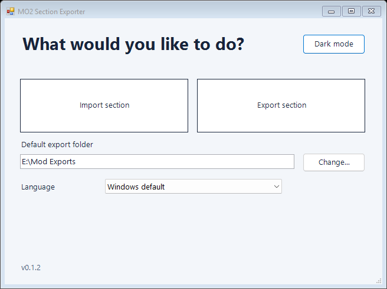
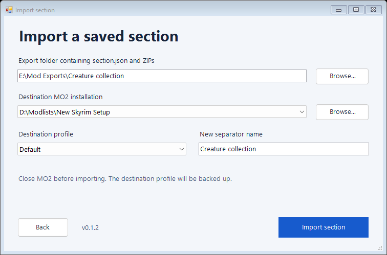

# MO2 Section Exporter

> **Work in progress.** The app is under active development. Keep your source modlist until you’ve verified the export and checked the imported section in the destination MO2 profile.

Portable Windows utility for carrying selected Skyrim Special Edition mods between Mod Organizer 2 instances.

## Benefits

- **Run one portable EXE across MO2 instances.** Use the same app for every supported portable instance without installing a plugin in each modlist.
- **Keep a section after uninstalling the source list.** Save the ZIPs and manifest outside the old installation, then import them later. Both modlists can use the same disk space at different times.
- **Reuse mods as configured.** The archives capture installed files, including FOMOD choices and local edits. Individual ZIPs restore separate entries with their relative priority and enabled states.
- **Review dependencies before moving.** See which mod requires each detected plugin master and flag SKSE or HDT-SMP runtime requirements for review.
- **Import in one pass.** Create a named separator in the destination profile. The importer checks for name collisions and backs up the profile's mod list.

## How to

Start the app and choose **Export section** or **Import section**.

### Export

1. Open the portable executable and select an MO2 installation, profile, and separator.
2. Search the checklist and choose which mods to bring. Filtering preserves selections outside the visible results.
3. Review the dependency table, choose whether to include resolved plugin masters, and select an export folder outside the source modlist.
4. Wait for ZIP verification to finish before deleting the source list.

**Individual ZIPs** preserves each installed mod as a separate archive. **Single merged ZIP** combines selected files using MO2 left-pane priority to resolve conflicts. Set ESP, ESM, and ESL load order in the destination profile.

The guided interface supports light and dark modes. Export progress, average speed, and elapsed time are displayed locally.

### Import

1. Close Mod Organizer 2, then choose **Import section**.
2. Choose the saved folder containing section.json and the ZIPs.
3. Pick the destination portable MO2 installation and profile. Enter a name for the new separator.
4. Click **Import section**, then reopen MO2 and check your right-pane plugin order.

Individual ZIPs restore separate mod entries, their relative priority, and their enabled states. A merged ZIP installs as one enabled mod. The app places the imported section at the high-priority end of the selected profile, rejects name collisions, and backs up modlist.txt before replacing it.

## Dependencies and stock files

The review follows declared plugin masters and shows which mod requires each one. It flags missing masters, SKSE DLLs, and HDT-SMP references found in loose meshes or configs. Verify runtime compatibility and any other requirements in the destination setup.

Recognized Skyrim stock files are excluded from both export formats. The destination modlist is expected to supply them. Loose replacers installed by mods are exported normally.

## Build

Run in Windows PowerShell:

    .\Build.ps1

The build uses the Windows .NET Framework compiler and produces one GUI executable. It uses the Windows PowerShell runtime that ships with Windows.

## AI assistance

This project was developed with assistance from OpenAI Codex. Codex assisted with implementation, interface concepts, and automated checks. Dependency detection can miss requirements, so review the export and test it in the destination modlist.

## License

The project source is licensed under the MIT License. Exported mods and assets remain subject to their original licenses.
